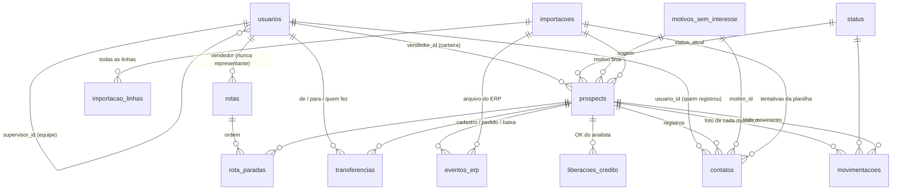

# 02 — Modelo de dados

Fonte da verdade: [`db/migrations/0001_inicial.sql`](../db/migrations/0001_inicial.sql). Este documento explica o porquê.

## Diagrama de vínculos

## Tabelas

### Referência e configuração

| Tabela | Para quê | Observações |
|---|---|---|
| `parametros` | prazos e limites editáveis | `prazo_cadastro_dias`=15, `prazo_analise_financeira_dias`=10, `dias_alerta_sem_lancamento`=7, `dias_alerta_sem_movimento`=30; painel (0002): `data_inicio_campanha`=2026-10-01 (data validada por trigger), `percentual_pipeline`=30, `valor_medio_cliente`=1200. Alteração gera linha em `auditoria`. |
| `feriados` | feriados **cadastrados** que não contam como úteis (0002, 0003) | data, descrição, abrangência `nacional` · `estadual` (UF) · `municipal` (UF + cidade), `recorrente` (repete todo ano, mesmo dia e mês). Os **nacionais não ficam aqui**: são calculados para qualquer ano (`shared/feriados.mjs`, inclusive a Sexta-feira Santa pela Páscoa). Vem com o 20/09 (RS) recorrente. Editável na tela (inclui/exclui). |
| `status` | os 8 status, cor e como contam nos indicadores | `aceita_contato`, `lista_trabalho` (aparece na lista de prospects), `conta_contactado`, `conta_carteira` (inválido = 0). |
| `perfis` (0008) | perfis de acesso | `nome`, `base` (tipo-base = perfil técnico: decide o escopo dos dados e as regras do banco), `sistema` (os 5 que vêm prontos; um por tipo-base). Usuário com `usuarios.perfil_id` NULL usa o perfil do sistema do seu tipo-base; gatilho exige que o tipo-base do perfil seja o `usuarios.perfil`. `ve_todos` (0009, só tipo-base supervisor): vê os dados de todas as equipes; registra só na própria. |
| `perfil_telas` (0008) | telas de cada perfil | `(perfil_id, tela)` — códigos em `shared/perfis.mjs`. O Administrador do sistema tem sempre todas (gatilho impede tirar). |
| `resumo_carteira` (0012) | resumo pronto da carteira | uma linha por vendedor × cidade × segmento × onda × rota × subrota × status: `qtd`, `atendidos`, `cadastrados`, `credito` (etapas do funil, mesma regra do Início) e `si_representante` (0015: dos sem interesse, os de motivo do representante). Mantido **só** pelos triggers `trg_resumo_carteira_ins/upd` em `prospects` (importação, atendimento, ERP, crédito, transferência ajustam na mesma transação). Ausente = `''`. Lido pela tela Explorar carteira e pelo Início (posição atual) no lugar da carteira inteira. |
| `motivos_sem_interesse` | lista de motivos de recusa | `origem` (0015: `cliente` \| `representante` — de quem é o sem interesse), `exige_observacao` (Outro), `uso_app` = 0 para motivos do sistema (`NAO_INFORMADO`, usado na importação inicial). |

### Pessoas

**`usuarios`** — administrador, supervisor e vendedor no mesmo cadastro.

| Coluna | Regra |
|---|---|
| `perfil` | `administrador` · `gerente` (gerente comercial — migração 0002) · `supervisor` · `vendedor` · `financeiro` (analista do console de crédito) |
| `codigo_erp` | COD (vendedor) ou COD SUP (supervisor) da planilha/Senior. Único por perfil. |
| `login` | criado pela importação: vendedor = código; supervisor = `sup` + código. Único, sem diferenciar maiúsculas. |
| `senha_hash` | PBKDF2; `NULL` = acesso ainda não liberado. A senha é **definida pelo administrador** na tela Usuários (mín. 8 caracteres) ou gerada aleatoriamente ("Gerar" / `npm run usuarios -- senha <login>`). `senha_provisoria` = 1 só para a gerada (indicador na tela; não há troca obrigatória no 1º acesso). `cofre_admin` (0005): só administrador — chave de administração cifrada com a senha dele (ADR-0006); senha de administrador com 8+ caracteres (prefira letras e números: é ela que protege o cofre). |
| `supervisor_id` | obrigatório para vendedor; precisa apontar para um supervisor (trigger). |
| `tipo_atuacao` | `representante` (sem rota) · `vendedor` (com rota). Preenchido pela lista do administrador (`npm run importar:tipos`). `NULL` = tratado como representante. |
| `ativo` | inativo não registra contato nem recebe transferência. |

Por que não há tabela `supervisores` separada: o supervisor também faz login e também pode ter carteira.

### Prospects

**`prospects`** — um CNPJ = um registro. Nunca é apagado.

| Grupo | Colunas |
|---|---|
| Identificação | `cnpj` (14, único, alfanumérico), `cnpj_raiz`, `cnpj_secundario` (2ª coluna CNPJ da planilha, se diferente) |
| Cadastro (da planilha) | razão social, fantasia, endereço, bairro, cidade, UF, CEP, lat/long, telefone, tipologia GTM, onda, tipo, rota, subrota, obs |
| Busca | `busca` (razão + fantasia + CNPJ + cidade + bairro, sem acento, maiúsculas), `cidade_busca`, `bairro_busca` |
| Carteira | `vendedor_id` (o supervisor vem de `usuarios.supervisor_id`) |
| Estado (só triggers mexem) | `status_atual` (Não contactado · Em prospecção · Aguardando cadastro · Sem interesse · Análise financeira · Aguardando pedido · Venda realizada · Inválido), `tentativas`, `dt_primeiro_contato`, `dt_segundo_contato`, `dt_ultimo_contato`, `data_proxima_acao`, `motivo_sem_interesse_id`, `dt_atendido`, `dt_pedido_informado`, `prazo_cadastro_ate` |
| ERP / crédito | `dt_cadastro_erp`, `codigo_cliente_erp`, `analise_financeira_ate`, `dt_liberacao_credito`, `forma_pagamento`, `prazo_pagamento_dias`, `limite_credito`, `limite_credito_origem`, `com_restricao_credito`, `convertido_sem_registro`, `dt_pedido`, `numero_pedido` |
| Baixa | `situacao_cadastral` (`ativa`/`baixada`), `dt_baixa` |
| Origem | `importacao_id`, `dt_entrada_base` (data de referência do 1º registro no histórico) |

"# Dias Corridos" da planilha **não é guardado**: é calculado em `vw_prospects.dias_corridos`
(hoje − DT 1o contato), sempre atualizado.

### Eventos (somente inclusão)

| Tabela | Quem grava | Efeito (trigger) |
|---|---|---|
| `contatos` | app (vendedor/supervisor/admin) e importação inicial (DT 1o / DT 2o) | aplica a regra de status, datas de tentativa, próxima ação, motivo final |
| `liberacoes_credito` | relatório de crédito (importação) ou analista (console) | `origem` (`importacao`/`console`), `forma_pagamento` (`antecipado` · `a_vista` · `boleto`), `prazo_pagamento_dias`, `limite_cnpj`, `limite_grupo`, `limite_credito` efetivo e `limite_origem` (`cnpj` · `grupo` · `informado`), `com_restricao` (console) → `aguardando_pedido`. CHECKs garantem: CNPJ prevalece, grupo só com CNPJ vazio, boleto exige limite |
| `eventos_erp` | importação de arquivos do ERP / baixados | cadastro → `analise_financeira`; pedido → `venda_realizada`; baixa → `invalido` + congelado. `valor` (0004): valor do pedido, só em `pedido`, ≥ 0, opcional |
| `transferencias` | supervisor da equipe ou administrador | troca `prospects.vendedor_id` |
| `movimentacoes` | **somente triggers** | **histórico de movimentação do cliente**: uma linha por movimento (entrada na base, contato da planilha, atendido, sem interesse, pedido identificado, cadastro, liberação de crédito, pedido, baixa, transferência) com status antes → depois, data, origem, **quem fez**, **vendedor dono da carteira no dia** e detalhe |

`contatos.resultado`: `atendido` · `sem_interesse` · `pedido_informado` (exige `data_pedido_informado`) —
os três do app; "não atendido" não gera registro. `contato_planilha` existe só para as datas DT 1o/2o da
importação inicial (origem `importacao`). `contatos.lote_id` agrupa registros feitos em lote.
`contatos.id` é texto (UUID gerado no aparelho): reenviar o mesmo contato após ficar offline não duplica.
`(prospect_id, numero_tentativa)` é único e precisa ser sequencial.

### Rotas (plano de trabalho do vendedor)

| Tabela | Conteúdo | Regras (triggers) |
|---|---|---|
| `rotas` | vendedor, data, nome, situação (`planejada` · `concluida` · `cancelada`) | só usuário vendedor com `tipo_atuacao = 'vendedor'`; não muda de dono; encerrada fica travada; nunca apagada (cancelar) |
| `rota_paradas` | rota, prospect, ordem | prospect da carteira do vendedor da rota, da lista principal ou em negociação; editável só enquanto a rota está planejada |

Rota é **plano**: pode ser reordenada enquanto planejada. O que foi feito é medido pelos contatos
(`vw_rota_paradas.atendida` = contato do vendedor naquele prospect na data da rota). Ordem manual — sem
cálculo de distância ([ADR-0005](adr/0005-sem-calculo-de-distancia.md)).

### Auditoria de carga

| Tabela | Conteúdo |
|---|---|
| `importacoes` | tipo (`base_prospects`, `cadastro_erp`, `pedido_erp`, `cnpj_baixado`, `tipo_atuacao`, `credito_erp`), arquivo, SHA-256, quem executou, contagens. CHECK: concluída ⇒ `lidas = aceitas + rejeitadas + ignoradas`. |
| `importacao_linhas` | **cada linha** do arquivo: resultado, mensagens (erros/avisos) e os dados brutos em JSON. |
| `auditoria` | ações administrativas (parâmetros, senhas, ativação). |
| `_migracoes` | controle das migrações aplicadas (SHA-256 de cada arquivo). |

## Views

| View | Uso |
|---|---|
| `vw_prospects` | carteira/ficha: prospect + status (nome, cor) + vendedor + supervisor + motivo + `vendedor_tipo_atuacao`, `status_descricao` ("Aguardando cadastro · atendido em dd/mm/aaaa"), `dias_corridos` (desde o 1º atendimento), `na_lista`, `pendente_hoje`, `retorno_pendente`, `atendido`, `prazo_cadastro_vencido`, `em_analise_financeira`, `dias_sem_movimento`, `parado` |
| `vw_movimentacoes` | histórico de movimentação com nomes (status, quem fez, vendedor da época, cidade/bairro) — linha do tempo da ficha e base de filtros |
| `vw_ultimo_lancamento` | dias sem lançar por vendedor (bloco de atenção) |
| `vw_rota_paradas` | paradas de cada rota, na ordem, com dados do prospect e `atendida` |
| `vw_rotas_execucao` | por rota: paradas planejadas × atendidas (vendedor, equipe) |
| `vw_ranking_motivos` | motivos finais de "sem interesse" por vendedor/supervisor |

## Índices
`prospects(vendedor_id, status_atual)`, `prospects(data_proxima_acao)`, `prospects(cidade_busca, uf, bairro_busca)`, `prospects(rota, subrota)`,
`prospects(cnpj_raiz)`, `contatos(usuario_id, data_contato)`, `contatos(data_contato)`,
`movimentacoes(prospect_id, data_evento, id)`, `eventos_erp` único por `(prospect, tipo, documento)`.

**Volume de produção (~50 mil CNPJs) — migração 0006**, decidida com `node scripts/medir-consultas.mjs [prospects] [--plano]`
(monta um banco temporário com o volume, mede cada consulta das telas e mostra o plano do SQLite):
- `contatos(prospect_id, data_contato)` — Início com período (contactado no período);
- `prospects(dt_ultimo_contato)` — filtro "último registro de/até" (57 → 10 ms com 50 mil);
- `prospects(status_atual)` e `prospects(razao_social)` — acompanhamento e ordenação pela coluna Prospect (71 → 3 ms);
- **busca por texto** com índice FTS5 *trigram* `prospects_busca` (sobre `prospects.busca`, mantido por gatilhos):
  o mesmo `LIKE '%termo%'` sem varrer a tabela (busca seletiva 70 → 2 ms; CNPJ 68 → 8 ms). O resultado é idêntico ao
  da busca antiga (teste em `test/carteira.test.mjs`); termos com menos de 3 letras continuam funcionando (sem índice).

**Complementares — migração 0007** (criados com o banco vazio, quando é instantâneo): histórico de movimentação por
status e por usuário no período; transferências por prospect e por vendedor (de/para); eventos do ERP por tipo no
período e por arquivo; liberações de crédito por analista, por relatório e por data; contatos e prospects por
importação e por motivo de recusa; rota_paradas por prospect; usuários por supervisor e por perfil; auditoria por
registro e por data; importações por tipo. Critério: só onde há consulta, ligação ou gatilho que procura pela coluna.
Custo medido: a carga de 50 mil CNPJs + 60 mil registros fica ~7% mais lenta (uma vez, na importação).
Ao criar tabela nova, já criar os índices das colunas usadas em filtro, ligação ou ordenação.

No Turso, tempo e cobrança seguem as **linhas lidas**: o vendedor lê só a própria carteira; a lista completa do
administrador/gerente na ordem de trabalho e as visões agrupadas (cidade, onda) e o Início leem a base toda — é o
custo de somar/ordenar tudo, sem mudar o que a tela mostra.
