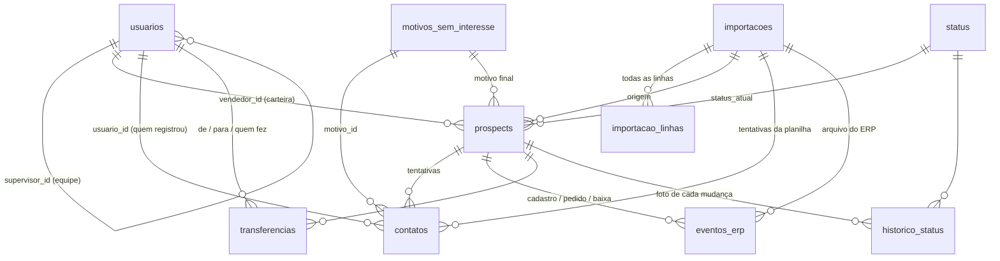

# 02 — Modelo de dados

Fonte da verdade: [`db/migrations/0001_inicial.sql`](../db/migrations/0001_inicial.sql). Este documento explica o porquê.

## Diagrama de vínculos

## Tabelas

### Referência e configuração

| Tabela | Para quê | Observações |
|---|---|---|
| `parametros` | prazos e limites editáveis | `tentativas_maximas`=2, `dias_entre_tentativas`=7, `prazo_cadastro_dias`=15, `prazo_analise_financeira_dias`=10, `dias_alerta_sem_lancamento`=7, `dias_alerta_sem_movimento`=30, `raio_gps_metros`=200. Alteração gera linha em `auditoria`. |
| `status` | os 7 status, cor e como contam nos indicadores | `aceita_contato`, `lista_trabalho` (aparece na lista de prospects), `conta_contactado`, `conta_carteira` (inválido = 0). |
| `motivos_sem_interesse` | lista de motivos de recusa | `exige_observacao` (Outro), `uso_app` = 0 para motivos do sistema (`SEM_RETORNO`, `NAO_INFORMADO`). |

### Pessoas

**`usuarios`** — administrador, supervisor e vendedor no mesmo cadastro.

| Coluna | Regra |
|---|---|
| `perfil` | `administrador` · `supervisor` · `vendedor` |
| `codigo_erp` | COD (vendedor) ou COD SUP (supervisor) da planilha/Senior. Único por perfil. |
| `login` | criado pela importação: vendedor = código; supervisor = `sup` + código. Único, sem diferenciar maiúsculas. |
| `senha_hash` | PBKDF2; `NULL` = acesso ainda não liberado (`npm run usuarios -- senha <login>`). |
| `supervisor_id` | obrigatório para vendedor; precisa apontar para um supervisor (trigger). |
| `tipo_atuacao` | `representante` (sem rota) · `vendedor` (com rota). `NULL` até o admin definir = tratado como representante. |
| `ativo` | inativo não registra contato nem recebe transferência. |

Por que não há tabela `supervisores` separada: o supervisor também faz login e também pode ter carteira.

### Prospects

**`prospects`** — um CNPJ = um registro. Nunca é apagado.

| Grupo | Colunas |
|---|---|
| Identificação | `cnpj` (14, único, alfanumérico), `cnpj_raiz`, `cnpj_secundario` (2ª coluna CNPJ da planilha, se diferente) |
| Cadastro (da planilha) | razão social, fantasia, endereço, bairro, cidade, UF, CEP, lat/long, telefone, tipologia GTM, onda, tipo, rota, subrota, obs |
| Busca | `busca` (razão + fantasia + CNPJ + cidade + bairro, sem acento, maiúsculas), `cidade_busca`, `bairro_busca` |
| Carteira | `vendedor_id` (o supervisor vem de `usuarios.supervisor_id`) |
| Estado (só triggers mexem) | `status_atual` (Não contactado · Em prospecção · Em negociação · Sem interesse · Cadastrado no ERP · Venda realizada · Inválido), `tentativas`, `dt_primeiro_contato`, `dt_segundo_contato`, `dt_ultimo_contato`, `data_proxima_acao`, `motivo_sem_interesse_id`, `dt_interesse`, `prazo_cadastro_ate` |
| ERP | `dt_cadastro_erp`, `codigo_cliente_erp`, `convertido_sem_registro`, `dt_pedido`, `numero_pedido`, `analise_financeira_ate` |
| Baixa | `situacao_cadastral` (`ativa`/`baixada`), `dt_baixa` |
| Origem | `importacao_id`, `dt_entrada_base` (data de referência do 1º registro no histórico) |

"# Dias Corridos" da planilha **não é guardado**: é calculado em `vw_prospects.dias_corridos`
(hoje − DT 1o contato), sempre atualizado.

### Eventos (somente inclusão)

| Tabela | Quem grava | Efeito (trigger) |
|---|---|---|
| `contatos` | app (vendedor/supervisor/admin) e importação inicial (DT 1o / DT 2o) | aplica a regra de status, datas de tentativa, próxima ação, motivo final |
| `eventos_erp` | importação de arquivos do ERP / baixados | cadastro → `cadastrado_erp`; pedido → `venda_realizada`; baixa → `invalido` + congelado |
| `transferencias` | supervisor da equipe ou administrador | troca `prospects.vendedor_id` |
| `historico_status` | **somente triggers** | uma linha por evento: status anterior → novo, data de negócio, origem |

`contatos.id` é texto (UUID gerado no aparelho): reenviar o mesmo contato após ficar offline não duplica.
`(prospect_id, numero_tentativa)` é único e precisa ser sequencial.

### Auditoria de carga

| Tabela | Conteúdo |
|---|---|
| `importacoes` | tipo, arquivo, SHA-256, quem executou, contagens. CHECK: concluída ⇒ `lidas = aceitas + rejeitadas + ignoradas`. |
| `importacao_linhas` | **cada linha** do arquivo: resultado, mensagens (erros/avisos) e os dados brutos em JSON. |
| `auditoria` | ações administrativas (parâmetros, senhas, ativação). |
| `_migracoes` | controle das migrações aplicadas (SHA-256 de cada arquivo). |

## Views

| View | Uso |
|---|---|
| `vw_prospects` | carteira/ficha: prospect + status (nome, cor) + vendedor + supervisor + motivo + `vendedor_tipo_atuacao`, `status_descricao` ("Em negociação · atendido em dd/mm/aaaa"), `dias_corridos` (desde o 1º atendimento), `na_lista`, `pendente_hoje`, `retorno_pendente`, `com_interesse`, `prazo_cadastro_vencido`, `em_analise_financeira`, `dias_sem_movimento`, `parado` |
| `vw_linha_tempo` | linha do tempo da ficha (contatos + eventos ERP + transferências) |
| `vw_ultimo_lancamento` | dias sem lançar por vendedor (bloco de atenção) |
| `vw_ranking_motivos` | motivos finais de "sem interesse" por vendedor/supervisor |

## Índices
`prospects(vendedor_id, status_atual)`, `prospects(data_proxima_acao)`, `prospects(cidade_busca, uf, bairro_busca)`, `prospects(rota, subrota)`,
`prospects(cnpj_raiz)`, `contatos(usuario_id, data_contato)`, `contatos(data_contato)`,
`historico_status(prospect_id, data_evento, id)`, `eventos_erp` único por `(prospect, tipo, documento)`.
