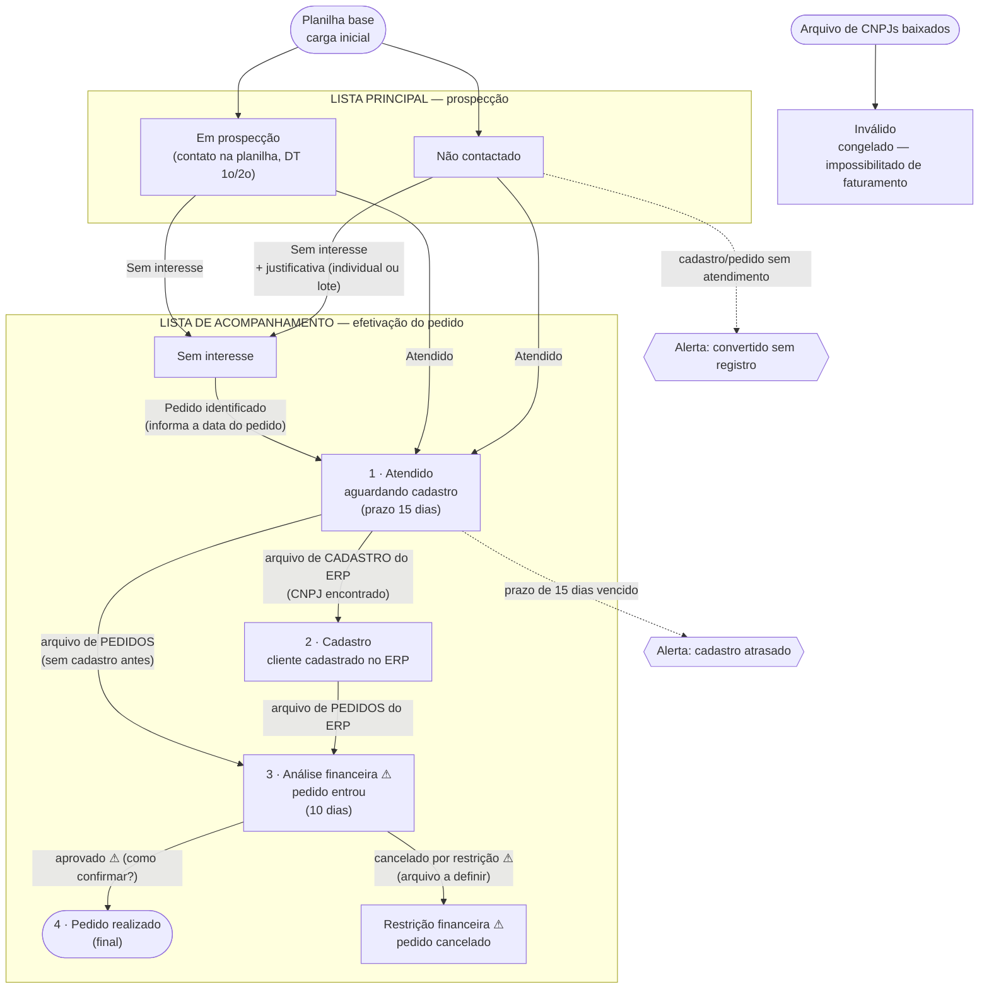

# 08 — Fluxo completo do processo (para validação)

**Situação:** proposta em validação (2026-10-19). As caixas marcadas com ⚠ mudam o que está implementado hoje.

## 1. Visão geral

Em qualquer etapa, um CNPJ que aparecer no arquivo de baixados vai para **Inválido** e fica congelado com o
histórico daquele momento.

## 2. Etapas

| # | Etapa | Lista | Como entra | Quem/qual arquivo | Prazo / alerta | Como sai |
|---|---|---|---|---|---|---|
| 0 | **Não contactado** | principal | carga inicial | planilha base | parado > 30 dias = alerta | Atendido ou Sem interesse |
| 0 | **Em prospecção** | principal | carga inicial com DT 1o/2o sem resultado | planilha base | idem | idem |
| — | **Sem interesse** | acompanhamento | registro com justificativa (motivo + observação), individual ou em lote | representante / vendedor | — | **Pedido identificado** (informa a data do pedido) → volta para Atendido |
| 1 | **Atendido** — aguardando cadastro | acompanhamento | registro "Atendido" | representante / vendedor | **15 dias** para aparecer no cadastro do ERP; vencido = alerta | arquivo de cadastro ou de pedidos |
| 2 | **Cadastro** | acompanhamento | CNPJ encontrado no arquivo de **cadastro de clientes** | importação do ERP | ⚠ prazo para o pedido? | arquivo de pedidos |
| 3 | **Análise financeira** ⚠ | acompanhamento | CNPJ encontrado no arquivo de **pedidos** | importação do ERP | **10 dias** | aprovado → Pedido realizado · cancelado → Restrição financeira |
| 4 | **Pedido realizado** | acompanhamento | análise financeira concluída | ⚠ a definir | — | final |
| — | **Restrição financeira** ⚠ | acompanhamento | pedido cancelado pela análise | ⚠ arquivo a definir | — | ⚠ volta para Atendido? encerra? |
| — | **Inválido** | — | CNPJ no arquivo de baixados | importação | — | congelado |

## 3. Regras que valem em todo o fluxo

- **Dias corridos** sempre a partir do **1º registro** do prospect (ou da DT 1o da planilha).
- "Não atendido" **não gera registro**: o prospect continua na lista principal.
- Cada mudança de etapa fica no histórico (data e origem) e **conta nos indicadores** de cada vendedor,
  de cada equipe e no geral, mesmo depois de sair da lista principal.
- Representante: só filtro, consulta e registros (atendido / sem interesse / pedido identificado).
  Vendedor: o mesmo + montagem de rotas.
- Nenhuma distância é calculada.

## 4. O que muda em relação ao implementado hoje

| Ponto | Hoje | Proposto |
|---|---|---|
| Nome da etapa 1 | status "Em negociação · atendido em dd/mm" | **"Atendido — aguardando cadastro"** (o nome "Em negociação" sai) |
| Arquivo de pedidos | leva direto a **Venda realizada**; os 10 dias são só um aviso | leva a **Análise financeira** (etapa própria, 10 dias) |
| Pedido realizado | = entrada do pedido | = **saída aprovada** da análise financeira |
| Pedido cancelado | não existe | etapa **Restrição financeira** |

## 5. Para validar

1. A ordem **Atendido → Cadastro → Análise financeira → Pedido realizado** está correta?
2. **Como a análise financeira termina?**
   a) automaticamente, depois de 10 dias sem cancelamento;
   b) por um arquivo do ERP (faturamento / notas emitidas);
   c) por um arquivo de pedidos cancelados (o que não estiver nele vira Pedido realizado após os 10 dias).
3. **Restrição financeira:** depois do cancelamento, o prospect volta para Atendido (nova tentativa), fica
   parado nesse status ou encerra?
4. **Depois do Cadastro**, existe prazo para o pedido entrar (como os 15 dias do cadastro)?
5. Se o **pedido** chegar sem o cadastro antes, pode pular direto para Análise financeira (como no desenho)?
6. O nome **"Atendido — aguardando cadastro"** substitui "Em negociação" em telas e relatórios?
