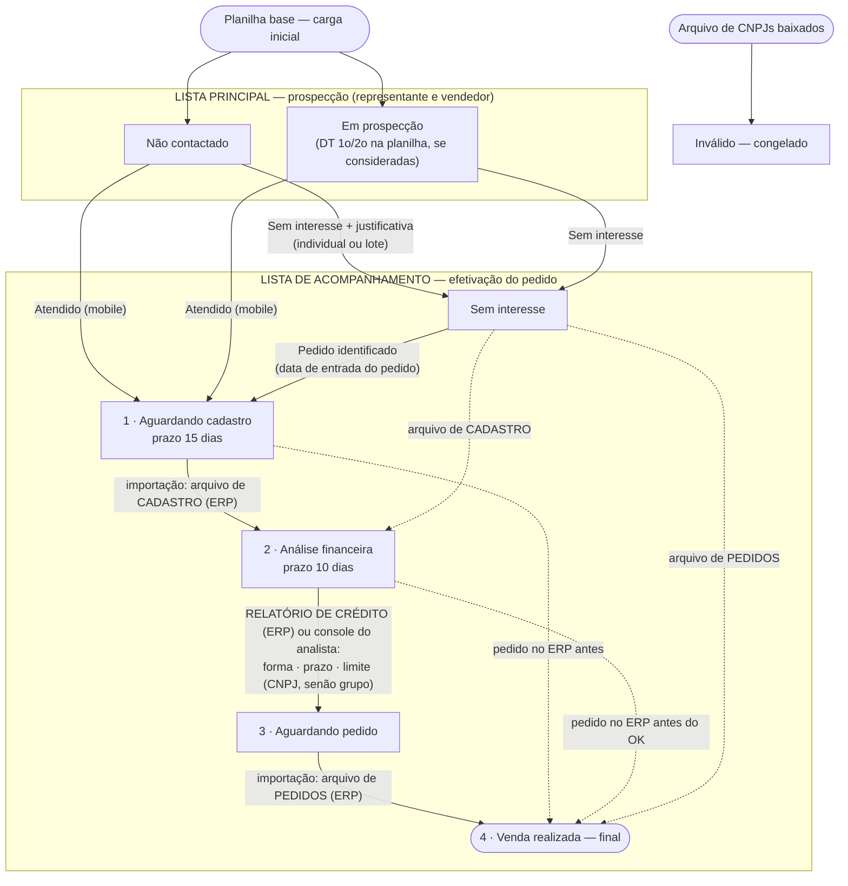

# 08 — Fluxo completo do processo

**Situação:** implementado no banco (2026-10-19). Versão de uma página para conferência:
[`fluxo-processo.pdf`](fluxo-processo.pdf).

## Etapas

| # | Etapa | Lista | Entra quando | Quem | Prazo / alerta |
|---|---|---|---|---|---|
| 0 | Não contactado / Em prospecção | principal | carga inicial (Em prospecção só se as datas DT 1o/2o forem consideradas) | — | parado > 30 dias |
| 1 | **Aguardando cadastro** | acompanhamento | "Atendido" no mobile (ou "Pedido identificado") | representante / vendedor | **15 dias** para o cadastro |
| 2 | **Análise financeira** | acompanhamento | CNPJ no arquivo de **cadastro** do ERP | importação (administrador) | **10 dias** para o OK |
| 3 | **Aguardando pedido** | acompanhamento | **relatório de crédito** do ERP (forma de pagamento, prazo em dias, limite do CNPJ — ou do grupo se o do CNPJ estiver vazio) **ou** OK no console do analista | administrador (importação) / analista | — |
| 3a | **Aguardando pedido válido** | acompanhamento | **pedidos** do ERP: houve pedido, nenhum válido (digitado ou cancelado) | importação | alerta após 10 dias |
| 4 | **Venda realizada** | acompanhamento | pedido em carteira ou faturado no arquivo de **pedidos** do ERP | importação | sai só se todos os válidos forem cancelados |
| — | Sem interesse | acompanhamento | registro com justificativa | representante / vendedor | reabre com "Pedido identificado" |
| — | Inválido | — | CNPJ no arquivo de baixados (a qualquer momento) | importação | congelado |

## Onde cada etapa aparece no app

| Etapa | Tela | Ação |
|---|---|---|
| Não contactado / Em prospecção | **Lista principal** (`#/carteira`) | abrir a ficha → **Registrar atendimento**; ou marcar vários → **Sem interesse em lote** |
| Aguardando cadastro · Análise financeira · Aguardando pedido · Venda realizada · Sem interesse · Inválido | **Acompanhamento** (`#/carteira?aba=acompanhamento`) → cartão do status | consulta; novo registro enquanto o status aceitar |
| Sem interesse → Aguardando cadastro | ficha → Registrar → **Reabrir: pedido identificado** | data de entrada do pedido |
| Cadastro · Pedido · Baixa · Relatório de crédito | Administração → importações | arquivos do ERP |
| Análise financeira → Aguardando pedido | **Console de crédito** (`#/financeiro`) → Liberar crédito | forma · prazo · limite · restrição; correção = nova liberação |
| Todos | **Ficha** (`#/ficha`) → Histórico de movimentação | linha do tempo de cada movimento |

## Histórico de movimentação

**Todo movimento** gera uma linha em `movimentacoes`: entrada na base, contato da planilha, atendido,
sem interesse, pedido identificado, cadastro, liberação de crédito, pedido, baixa e transferência de carteira.
Cada linha guarda data, status antes → depois, **quem fez**, **de quem era a carteira naquele dia** e o detalhe
(motivo, nº do documento, limite liberado). É a base de:

- **linha do tempo** da ficha do cliente (`vw_movimentacoes`);
- **filtros** de consulta e relatório (`consultaMovimentacoes`: período, tipo, status, vendedor, equipe, cidade, bairro);
- **indicadores** de atividade e funil por vendedor, equipe e geral (`consultaAtividade`).

## Regras gerais
- O **relatório de crédito** registra também o cadastro quando o cliente ainda não tinha (data de cadastro + cód. interno).
- **Os arquivos do ERP prevalecem:** cadastro → Análise financeira e pedido → Venda realizada para qualquer cliente
  da base, inclusive Sem interesse e Não contactado (alerta "convertido sem registro" quando não houve atendimento).
- "Não atendido" não gera registro; dias corridos contam sempre do 1º registro.
- Saiu da lista principal → continua no acompanhamento e **em todos os indicadores**.
- Representante: filtro, consulta e registros. Vendedor: também monta rotas. Nenhuma distância é calculada.
